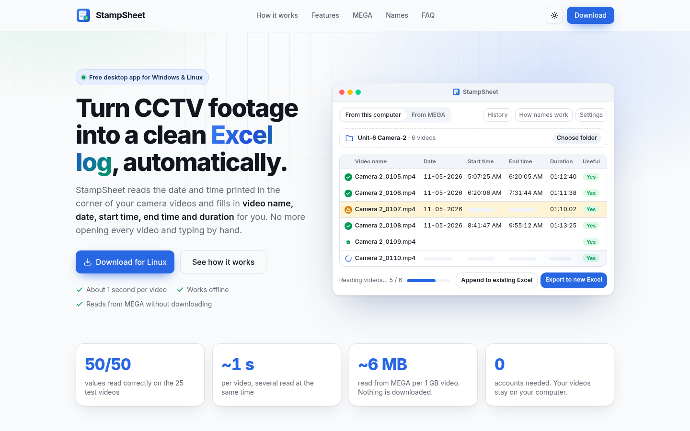
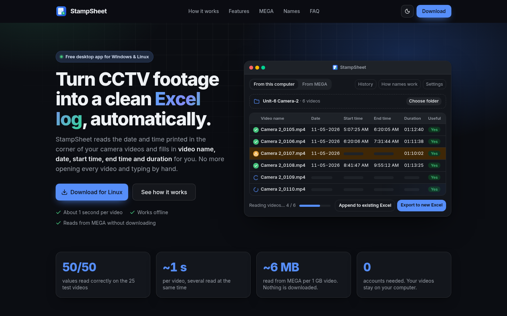
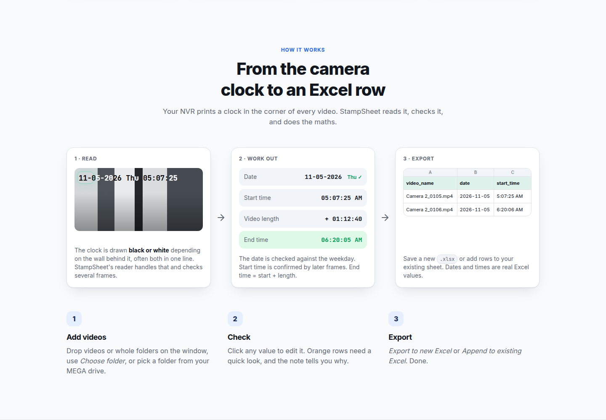
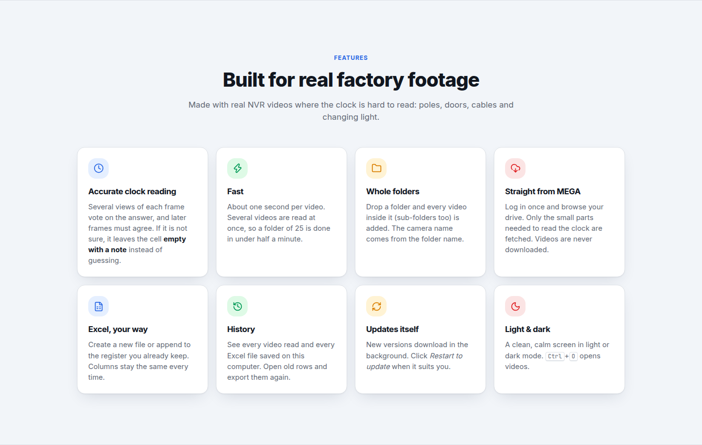
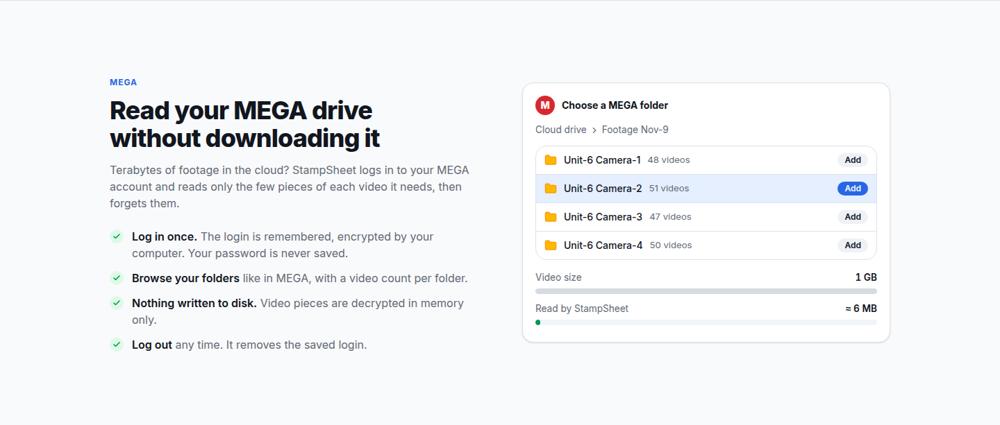
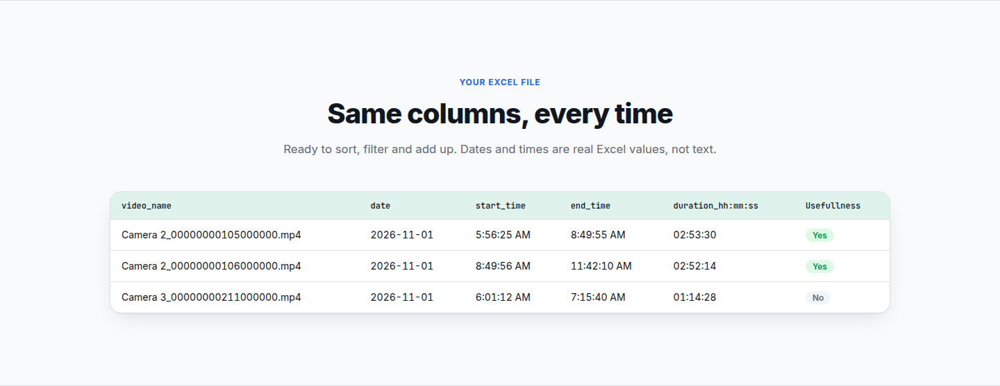
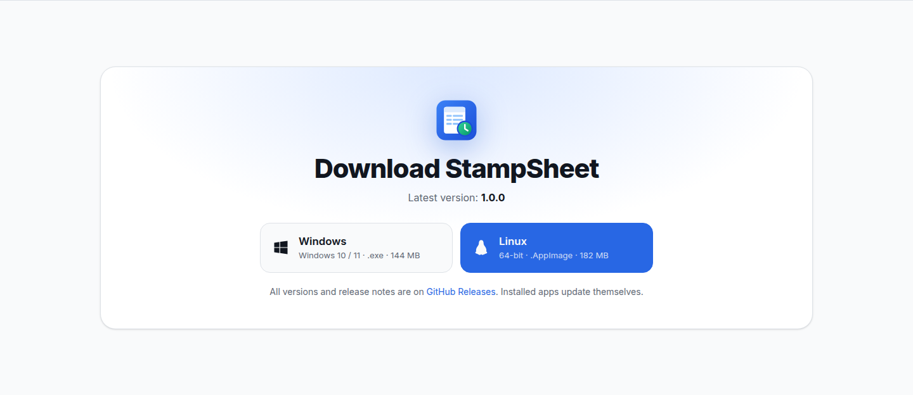
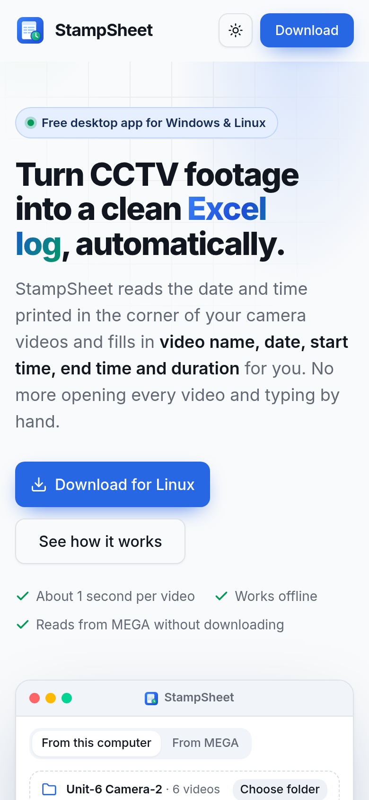

# StampSheet website

One-page website for the StampSheet desktop app, which reads the clock printed on CCTV/NVR footage and turns it into an
Excel log. Built with the same stack and theme as the app's screen:
React 19 + TypeScript + Vite 8 + Tailwind CSS 4 + shadcn/ui (new-york) + motion + lucide + next-themes + Inter.

<p align="center">
  
</p>

## Contents

- [Screenshots](#screenshots)
- [Commands](#commands)
- [Files](#files)
- [Download links](#download-links)
- [Adding shadcn components](#adding-shadcn-components)
- [Updating the screenshots](#updating-the-screenshots)
- [Publish](#publish)

## Screenshots

All screenshots are taken at 1440 px wide (mobile at 390 px). The [full page](docs/screenshots/full-page.png) shows every
section in one image.

### Light and dark theme

The theme follows the visitor's system and can be switched in the header.

| Light | Dark |
| :---: | :---: |
|  |  |

### How it works — `HowItWorks.tsx`, `ClockFrame.tsx`

The camera clock (with mixed black/white characters) → working out date, start, length and end → an Excel row, then
the three steps a user follows.



### Features — `Features.tsx`



### MEGA — `Mega.tsx`



### Excel sample — `ExcelSample.tsx`



### Download — `Download.tsx`

Version, file type and size come live from the latest GitHub release (see [Download links](#download-links)).



### Mobile

<p align="center">
  
</p>

## Commands

```bash
npm install        # install packages
npm run dev        # live preview at http://localhost:5174
npm run typecheck  # TypeScript check
npm run build      # type check + build the static site into dist/
npm run preview    # serve dist/ to check the built site
```

## Files

```
index.html                  page title, description, icons
public/                     icon.svg, icon.png (from the app's build/ folder)
docs/screenshots/           images used in this README
src/main.tsx                theme provider (light / dark / system), motion, tooltips
src/App.tsx                 page sections in order
src/index.css               theme tokens (same as vmeta/ui/src/index.css) + a few site styles
src/lib/release.ts          latest GitHub release: version + direct .exe / .AppImage links
src/components/ui/          shadcn/ui components (button, badge, card, table, tooltip, accordion)
src/components/site/
  Header.tsx                logo, section links, theme switch, Download
  Hero.tsx                  headline + download button for the visitor's system
  AppPreview.tsx            animated copy of the app window (videos being read)
  Stats.tsx                 key numbers
  HowItWorks.tsx            clock → work out → Excel, and the 3 steps
  ClockFrame.tsx            camera clock with mixed black/white characters
  Features.tsx, Mega.tsx, Names.tsx, ExcelSample.tsx, Privacy.tsx, Download.tsx, Faq.tsx, Footer.tsx
  Section.tsx               shared layout pieces (Section, SectionHead, Reveal, Code)
```

## Download links

`src/lib/release.ts` asks the GitHub API for the latest release of
`Muhammad-Usman-911/StampSheet-ElectronApp-VideotoExcel` and links the Windows / Linux buttons straight to the files,
with version and size. If GitHub can't be reached, the buttons open the Releases page. Nothing needs to change here
when a new app version is released. If the repository is renamed, change `REPO` in that file.

## Adding shadcn components

`npx shadcn@latest add <name>`. Check the new file's imports: the CLI sometimes writes `import { cn } from "cn"`;
change it to `@/lib/utils` (and `npm uninstall cn` if it installed that package).

## Updating the screenshots

After changing the page, run `npm run dev` and retake the images in `docs/screenshots/` at a 1440 × 900 window
(mobile: 390 px wide at 2× scale), keeping the same file names so this README picks them up.

## Publish

`npm run build`, then host the `dist/` folder (paths are relative, so any sub-folder works):

- **GitHub Pages:** push this folder to a repository and deploy `dist/` (e.g. with the official "Deploy static content" action).
- **Netlify / Vercel / Cloudflare Pages:** build command `npm run build`, output folder `dist`.
